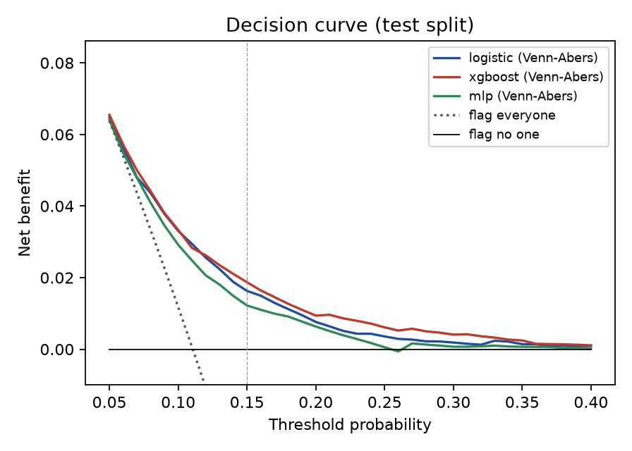

```{=typst}
#show <refs>: set par(hanging-indent: 0.5in, first-line-indent: 0pt, justify: false)
#set text(hyphenate: false)
#set bibliography(title: "References")
#show cite: set text(fill: rgb("#1f4e9e"))
#show bibliography: set par(justify: false)
// Three-rule tables (top, below header, bottom) and bold "Figure N" / "Table N" labels
#set table.hline(stroke: 0.6pt)
#show table: it => box(stroke: (top: 1pt, bottom: 1pt), it)
#show figure.caption: it => context [#strong[#it.supplement~#it.counter.display(it.numbering)#it.separator]#it.body]
#show table: set par(justify: false)
#show heading.where(level: 1): it => block(above: 1.2em, below: 0.6em)[
  #set text(fill: rgb("#1f4e9e"), size: 14pt, weight: "bold")
  #it
]
#show heading.where(level: 2): set text(fill: rgb("#2d2d2d"), size: 11.5pt)
#let glance(body) = block(fill: rgb("#eef3fb"), stroke: (left: 3pt + rgb("#1f4e9e")), inset: 10pt, radius: 2pt, width: 100%, body)
// Header: red title, subtitle, author, repository link
#align(center)[
  #set par(justify: false)
  #text(size: 17pt, weight: "bold", fill: rgb("#b91c1c"))[Hospital Readmission Risk Audit]
  #v(0.5em)
  #text(size: 12pt, weight: "bold")[Predicting 30-day hospital readmission, and checking whether the predictions are trustworthy, useful and fair]
  #v(0.9em)
  #text(size: 11pt)[Reagan Kesseku, Ph.D.]
  #linebreak()
  #text(size: 10pt)[#link("https://github.com/rkesseku/readmission-risk-audit")[github.com/rkesseku/readmission-risk-audit]]
  #v(0.45em)
  #text(size: 9.5pt)[#emph[Keywords:] hospital readmission, clinical prediction models, calibration, decision curve analysis, algorithmic fairness]
]
#v(0.5em)
```

```{=typst}
#glance[
*At a glance* \
*Problem:* Hospitals want to know which discharged patients are likely to return within 30 days, so that follow-up calls and early clinic visits reach the right people. A useful model must rank patients well, give probabilities that mean what they say, beat simple alternatives, and work comparably across patient groups. \
*What I built:* A reproducible study on 99,340 encounters from the public UCI Diabetes 130-US Hospitals data. It uses patient-level splits, leak-free patient-history features, three model families, three calibrators, decision-curve analysis, a subgroup fairness audit, SHAP explanations and a model card. Each headline number carries a 95% CI from a bootstrap that resamples patients. \
*Headline result:* XGBoost reached test AUROC *0.688 (95% CI 0.675–0.702)*. That is +0.008 over the first version (paired CI +0.003 to +0.014). The gain came almost entirely from history features, and every choice was made without touching the test set. XGBoost leads a logistic regression tuned on the same validation data by +0.011 (paired CI +0.006 to +0.017), a small but clear margin. At a 0.15 risk threshold it catches 46% of readmissions while flagging 23% of discharges, for a net benefit of 0.019 vs. −0.046 for "call everyone". The audit found lower sensitivity for men and for patients with unrecorded race. \
*Stack:* Python, pandas, scikit-learn, XGBoost (TreeSHAP), Optuna, matplotlib, pytest, GitHub Actions. \
*Repo:* #link("https://github.com/rkesseku/readmission-risk-audit")[github.com/rkesseku/readmission-risk-audit]
]
```

# The problem

Unplanned readmissions within 30 days are costly and often signal that a patient left without enough support. Hospitals respond with post-discharge interventions (a nurse call, medication review, an early clinic visit). These cannot be given to everyone, so a risk model decides who gets them.

Published models usually report one number, the area under the ROC curve (AUROC), which measures how well a model *ranks* patients. A team deciding whether to rely on a model needs to know more.

1. *Calibration.* If the model says a patient has a 20% risk, do about 20% of such patients actually return?
2. *Clinical utility.* Does acting on the model beat intervening for everyone or for no one, once the cost of unnecessary interventions is counted?
3. *Fairness.* Does the model miss more readmissions in some patient groups than in others?
4. *Sound evaluation.* The same patient often has several stays. If one patient's stays land in both training and test data, the test score is inflated and misleading.

## The data

The UCI *Diabetes 130-US Hospitals* dataset [@strack2014] contains 101,766 inpatient encounters for patients with diabetes from 130 US hospitals between 1999 and 2008. Following Strack et al., encounters ending in death or hospice are removed and diagnoses are grouped into nine categories. This leaves 99,340 encounters from 69,987 patients, of whom 11.3% were readmitted within 30 days.



# Approach

{#fig-arch width=92%}

1. *Leak-free splits.* Patients are randomly assigned 60/20/20 to training, calibration and test sets, so no patient appears in two of them. Within the training set, 15% of patients are held out for early stopping and tuning.
2. *Features* (257 in total). Counts of prior health-care use, 23 diabetes-medication flags, age and one-hot categories (admission type, discharge destination, specialty, payer, diagnosis groups). *History features* are built only from each patient's **earlier** encounters: how many there were, how many were followed by a readmission, and prior inpatient days. The data has no dates, so encounter-id order stands in for time. A unit test checks that changing a later encounter never changes an earlier feature. *Diagnosis detail* adds ICD-9 chapters and 13 comorbidity flags (heart failure, kidney disease, COPD and others).
3. *Models:* regularised logistic regression, XGBoost [@chen2016xgboost] (hyperparameters from a 50-trial Optuna [@akiba2019] search on the validation split) and a small neural network. To keep the comparison fair, I tune the two baselines on the same validation split, searching the logistic regression's regularisation strength over a 7-point log grid, and the network's width and weight decay over a 12-point grid. The final model is chosen by AUROC on the calibration set.
4. *Calibration:* Platt scaling, isotonic regression and inductive Venn-Abers [@vovk2014], fitted on the calibration set. Venn-Abers was fixed in advance as the headline method.
5. *Metrics with honest uncertainty.* I report AUROC, precision-recall area, Brier score, expected calibration error (ECE) and calibration slope. CIs come from 500 bootstrap draws that resample *patients*, because stays from the same patient are correlated. Comparisons use paired bootstraps.
6. *Utility and fairness.* I compute net benefit [@vickers2006] across risk thresholds. For each age band, sex and recorded race, I report the observed/expected ratio (O/E), sensitivity (TPR) and false-positive rate at a 0.15 threshold, each with a CI.
7. *Explanations:* exact TreeSHAP values [@lundberg2020], plus a model card [@mitchell2019] covering intended use and caveats.

Two commands reproduce everything: `readmit experiment` (the improvement study, about 35 CPU minutes) and `readmit run-all` (baseline tuning and the full study, about 12 minutes on 2 threads). Every number in this brief is written to `docs/results/`.



# Results

The test set contains 19,944 encounters from 13,998 patients (11.1% readmitted).

## Improving the model without peeking at the test set

| Step (XGBoost) | Validation | Calibration | Test | Test Δ vs. original (95% CI) |
|----------------------------------|-------------|--------------|--------|-------------------------------|
| (0) Original (v0.1.0) | 0.677 | 0.673 | 0.6805 | – |
| (1) + history features | 0.689 | 0.684 | 0.6883 | +0.0079 (+0.0041, +0.0119) |
| (2) + chapters, comorbidities | 0.690 | 0.685 | **0.6885** | **+0.0081** (+0.0030, +0.0135) |
| (3) + Optuna (50 trials) | **0.693** | **0.687** | 0.6883 | +0.0078 (+0.0027, +0.0135) |

: AUROC by step. A step was kept only if it improved both validation and calibration AUROC, and all three were kept. Bold marks the highest value in each column. {#tbl-exp}

History features delivered essentially the entire gain. Diagnosis detail and tuning passed the selection rule by small margins but did not move the test AUROC. That pattern usually means the remaining signal is limited by what the data records rather than by the model.

## Final models

| Model | AUROC (95% CI) | PR area | Brier | ECE raw | ECE Venn-Abers |
|--------------------------|--------------------------|----------|---------|----------|-------------------|
| XGBoost (selected) | **0.688** (0.675–0.702) | **0.242** | **0.0926** | **0.0044** | 0.0089 |
| Logistic regression | 0.677 (0.663–0.692) | 0.226 | 0.0936 | 0.0070 | **0.0078** |
| Neural network | 0.667 (0.653–0.682) | 0.214 | 0.0949 | 0.0201 | 0.0086 |

: Test-set results with the final features, with both baselines tuned on the validation split. XGBoost beats logistic regression by 0.011 AUROC (paired CI 0.006–0.017) and the network by 0.022 (0.014–0.029). Bold marks the best value in each column (highest AUROC and PR area, lowest Brier score and ECE). {#tbl-results}

*Fair baselines.* Before tuning, logistic regression used a fixed regularisation strength and the network a fixed size, while XGBoost had 50 tuning trials. Tuning both on the same validation split barely changed logistic regression (its test AUROC rose from 0.676 to 0.677, and its gap to XGBoost narrowed from 0.012 to 0.011) and lifted the network from 0.657 to 0.667. XGBoost's lead is therefore not an artefact of uneven tuning, but it is small.

*Calibration, a useful negative result.* XGBoost's raw probabilities were already well calibrated (ECE 0.004, slope 1.04), and Venn-Abers did not improve them (paired ECE difference −0.0045, CI −0.0052 to +0.0016). The calibration set happens to have a slightly higher readmission rate (11.7%) than the test set (11.1%), and the calibrators carry that offset into their test predictions. The neural network, whose raw output was overconfident (slope 0.69), did benefit: its ECE fell from 0.020 to 0.009. The lesson is to calibrate when there is evidence that it is needed rather than by reflex.



## Is the model worth acting on?

{#fig-dca width=52%}

At a 0.15 threshold (equivalent to judging that preventing one readmission is worth flagging roughly 5.7 patients unnecessarily), the model flags 22.9% of discharges and catches 45.6% of readmissions. Of the flagged patients, 22.1% are readmitted, about twice the base rate. Net benefit is 0.0190 (95% CI 0.0148–0.0233), up from 0.0155 in the first version, compared with −0.046 for calling everyone.

## Fairness audit

{#fig-fair width=80%}

* *Sex and age.* Sensitivity was 0.49 for women vs. 0.41 for men, and 0.52 for patients under 50 vs. 0.44–0.45 for older age bands.
* *Race.* African American and Caucasian patients had similar sensitivity (0.46 vs. 0.46). Patients with race recorded as *unknown* (459) or *Other* (355) were flagged rarely (6.5% and 11.5%, vs. 22.9% overall), with sensitivities of 0.10 and 0.31. The intervals are wide, but the pattern would need to be explained before deployment. Asian patients (138) were too few for a reliable estimate.



## What drives the predictions

By mean absolute SHAP value, the strongest predictors are discharge destination, inpatient visits in the prior year, the history feature *maximum earlier inpatient count*, medical specialty and payer. Payer is a plausible proxy for socioeconomic status, which the model card flags for review.

# What this demonstrates

* *Evaluation that matches the deployment question.* Calibration, net benefit and subgroup performance are reported alongside AUROC.
* *Disciplined model improvement.* Feature engineering and tuning were chosen on validation and calibration data under a pre-stated rule, and the test gain is reported as a paired CI, including for the steps that did not help.
* *Leakage control.* Patient-level splits, history features that are provably backward-looking, and patient-clustered bootstrap CIs.
* *Engineering hygiene.* A tested package (synthetic-data tests, including a no-leakage test, so CI needs no data download), one-command reproduction, CI on Python 3.10–3.12, and a model card.

# Limitations and next steps

* Encounter-id order is a proxy for time. At deployment the history features need the patient's real EHR history as of discharge.
* One public dataset from 1999–2008, one random split and one seed. Without dates or hospital identifiers, temporal and external validation are impossible here, and both would be required before real use.
* The label records only readmissions to the same health system, and the share of readmissions captured this way may differ by group.
* Next: repeated splits to measure split-to-split variance, group-aware thresholds, a payer-free model, and a calibration-drift monitoring plan.

# How to run it

```bash
pip install -e ".[dev]"
# download and unzip the UCI zip into data/raw/ (see README)
readmit experiment && readmit run-all
pytest && ruff check src tests
```

# References {.unnumbered}

::: {#refs}
:::
